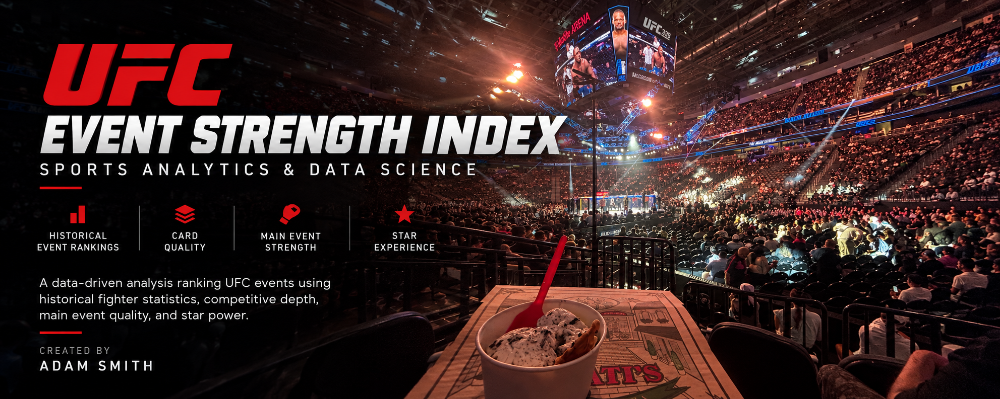
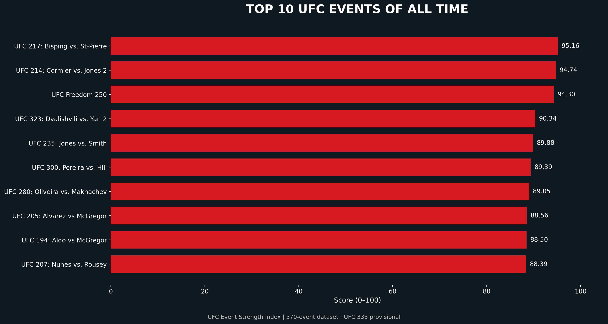
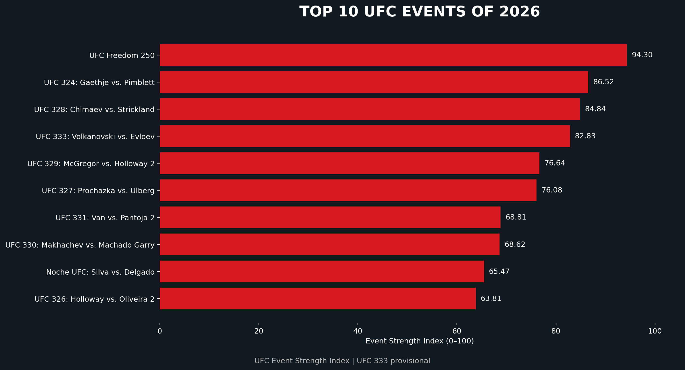
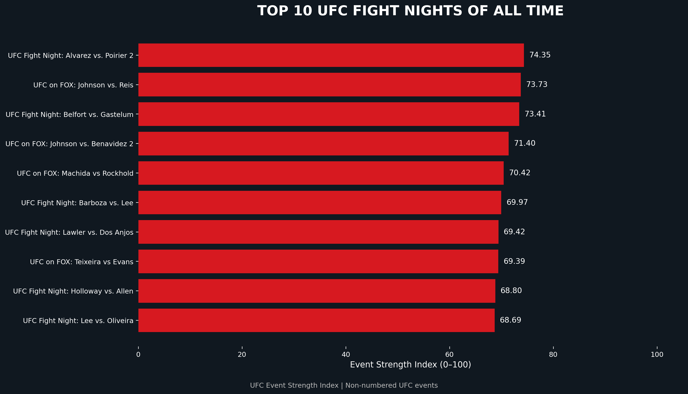
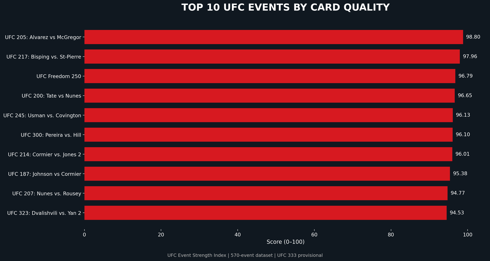
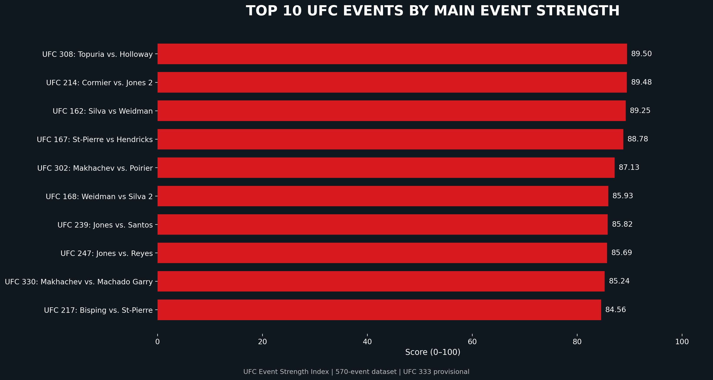
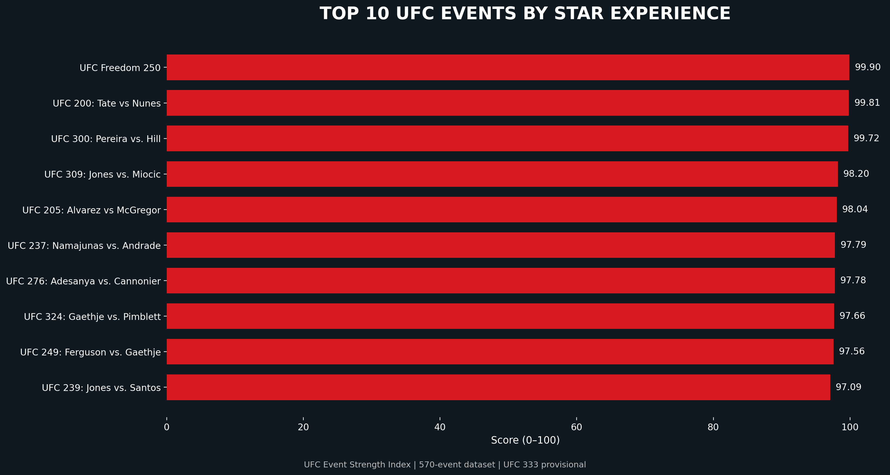

# UFC Event Strength Index

**A data-driven sports analytics project evaluating and ranking UFC events using historical fighter statistics, competitive depth, main event quality, and star power.**

Created by **Adam Smith**.

## Project Overview

The UFC Event Strength Index (ESI) is a Python-based analytics model designed to evaluate the strength of UFC fight cards.

The project ranks 570 UFC events using historical fighter and event data. Rather than judging an event solely by its main event, the model evaluates the overall quality and strength of the entire fight card.

The model focuses on three major components:

- **Card Quality:** Evaluates fighter talent, experience, and competitive depth across the card.
- **Main Event Strength:** Measures the quality and significance of the main event matchup.
- **Star Experience:** Evaluates the experience, accomplishments, and recognition of fighters on the card.

The project includes historical event comparisons, statistical analysis, data visualizations, and provisional 2026 estimates.

## Project Technologies

- Python
- Pandas
- NumPy
- Jupyter Notebook
- Matplotlib
- Data Analysis
- Statistical Modeling
---

# UFC Event Rankings & Visualizations

The following visualizations highlight the highest-rated UFC events across the Event Strength Index and its individual scoring categories.

## Top 10 UFC Events of All Time

## Top 10 UFC Events of 2026

*Includes provisional 2026 event estimates.*

## Top 10 UFC Fight Nights of All Time

*Excludes numbered UFC events.*

## Top 10 Events — Card Quality

## Top 10 Events — Main Event Strength

## Top 10 Events — Star Experience

---

Created by **Adam Smith**.
