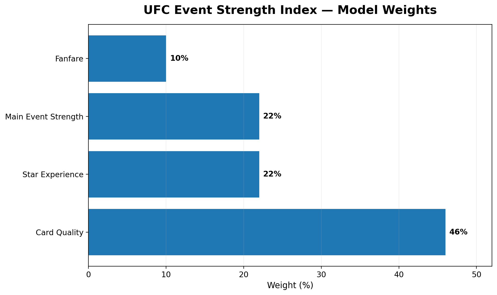
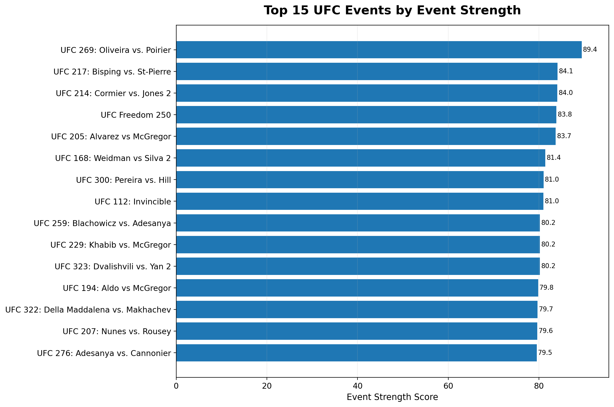
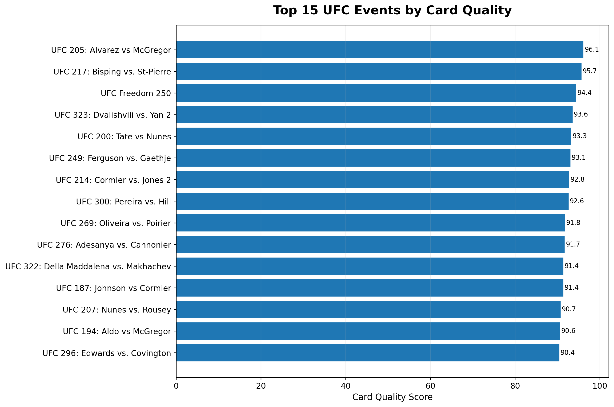
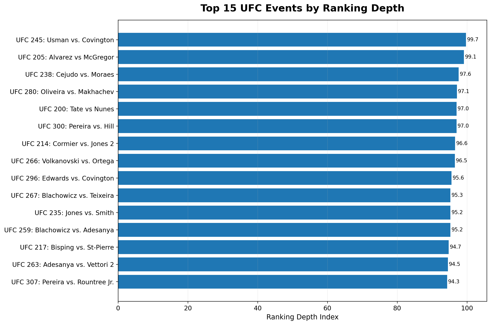
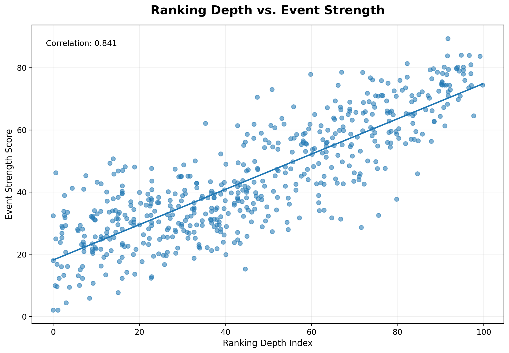
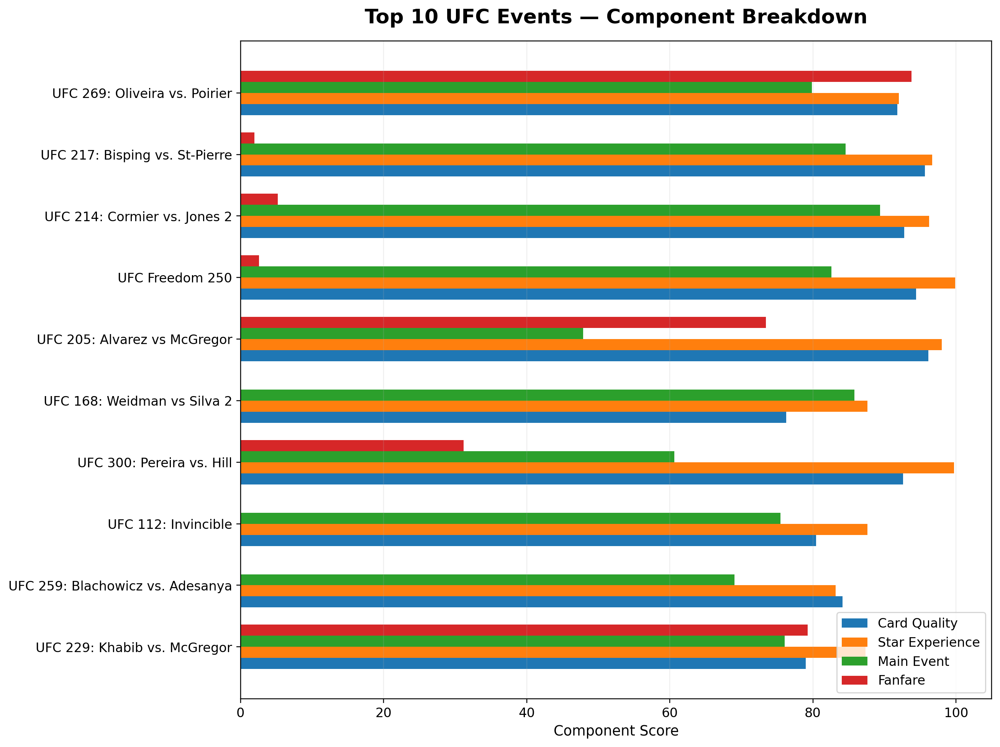
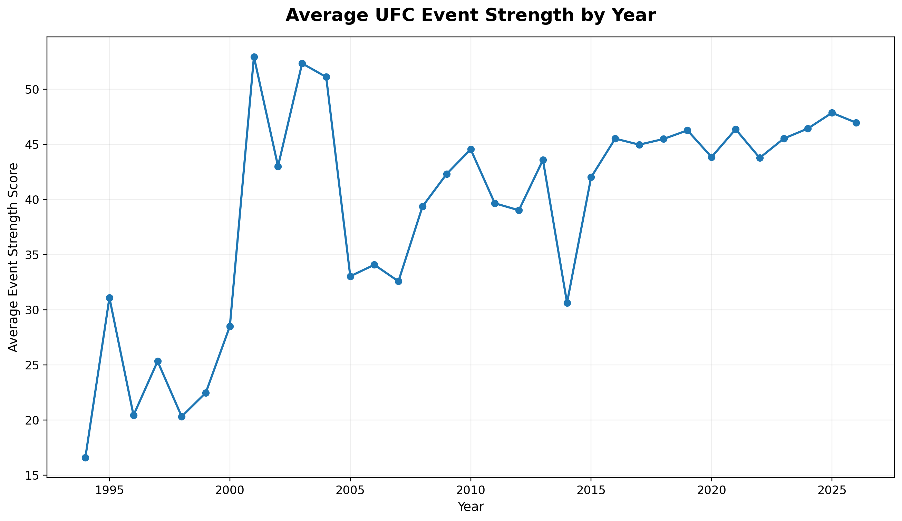

# UFC Event Strength Index

**A data-driven analysis of UFC event strength, covering 788 events through September 19, 2026.**

Created by **Adam Votto**.

## Project Overview

The UFC Event Strength Index evaluates and ranks UFC events using fighter experience, competitive strength, ranking depth, main event quality, and fan interest.

The goal is to measure the strength of an entire UFC fight card rather than judging an event solely by its main event or popularity.

The dataset includes **788 UFC events and historical information from 8,877 fights**.

## How the Model Works

Each event receives an overall Event Strength Score based on four components:

| Component | Weight |
|---|---:|
| Card Quality | 46% |
| Star Experience | 22% |
| Main Event Strength | 22% |
| Fanfare | 10% |

Missing data is handled by redistributing weight among available components rather than automatically treating missing information as zero.

### Card Quality

Card Quality evaluates the overall competitive strength of the fight card using:

| Metric | Weight within Card Quality |
|---|---:|
| Ranking Depth | 30% |
| Title Fights | 14% |
| UFC Experience | 14% |
| UFC Win Percentage | 14% |
| Win Streaks | 14% |
| Finish Rate | 14% |

### Ranking Depth Index

The Ranking Depth Index evaluates the strength and distribution of ranked fighters across an event.

| Metric | Weight |
|---|---:|
| Total Ranking Points | 45% |
| Ranked Fighter Breadth | 25% |
| Ranked Matchups | 20% |
| Title Fights | 10% |

Ranking Depth helps distinguish events with strong overall cards from events that rely primarily on one or two prominent fights.

## Highest-Ranked UFC Events

The model's top five events are:

| Rank | UFC Event | Event Strength Score |
|---|---|---:|
| 1 | UFC 269: Oliveira vs. Poirier | 89.41 |
| 2 | UFC 217: Bisping vs. St-Pierre | 84.08 |
| 3 | UFC 214: Cormier vs. Jones 2 | 84.03 |
| 4 | UFC Freedom 250 | 83.85 |
| 5 | UFC 205: Alvarez vs McGregor | 83.67 |

## Data Visualizations

### Top 15 UFC Events by Card Quality

### Top 15 UFC Events by Ranking Depth

### Ranking Depth vs. Overall Event Strength

Among the 564 events with ranking-depth data, the Ranking Depth Index has a correlation of approximately **0.841** with overall Event Strength.

This is a descriptive relationship; Ranking Depth is itself one of the model's scoring inputs.

### Top 10 UFC Events — Component Breakdown

This visualization shows how the four components contribute to the profiles of the highest-ranked UFC events.

### Average Event Strength by Year

## Data and Methodology

The model uses historical fight and event data, including title fights, fighter experience, win percentages, win streaks, finish rates, and ranking information.

Fighter statistics are evaluated using information available before each event, avoiding future-result leakage.

Ranking data is not assumed to exist for periods where reliable historical rankings are unavailable.

Fanfare uses available audience, historical drawing, and search-interest measures. Coverage varies across events, and the current Fanfare component does not yet fully measure every fighter's popularity across the card.

For more information, see [METHODOLOGY.md](METHODOLOGY.md).

## Project Files

- **Event dataset:** `UFC_EVENT_STRENGTH_V2_SANDBOX_2026-09-19.csv`
- **Python analysis notebook:** `UFC_Event_Strength_Index (2).ipynb`
- **Visualizations:** `visuals/`
- **Detailed methodology:** `METHODOLOGY.md`

## Future Development

Potential improvements include expanding historical ranking coverage, developing more complete whole-card popularity measurements, and validating event-strength scores against independent external indicators.

The current scores are model-generated estimates of event strength, not objective measures of entertainment quality or fight outcomes.

---

**Author:** Adam Votto  
**Project:** UFC Event Strength Index  
**Data updated through:** September 19, 2026
